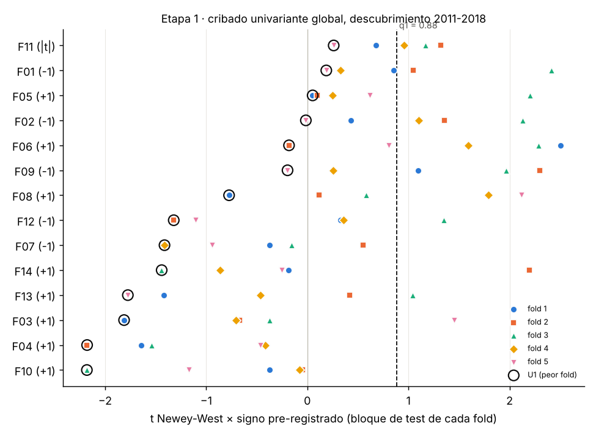
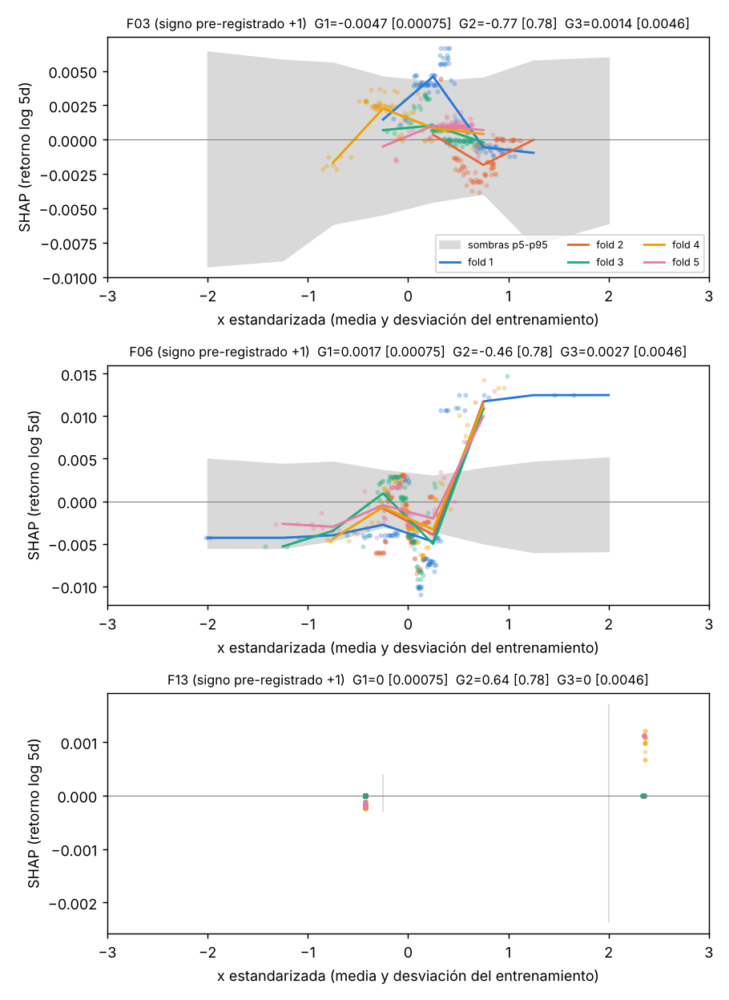

# Línea 1A · Informe de resultados

Fecha de ejecución: 2026-10-24 · pre-registro `preregistro/preregistro_1A.yaml`
(SHA-256 `560ae5f0…32d5`, grabado en cada entrada de `trials.jsonl`).
Datos y librerías: repositorio de Stefan Jansen, *Machine Learning for Trading* 3.ª ed. (ver README).

## Resumen

**Resultado nulo.** Ninguna de las 14 candidatas tiene un efecto de signo y forma estables sobre el retorno
a 5 días del S&P 500 en los cinco folds de descubrimiento (2011-2018) frente a la nula de sombras circulares.
Las tres excepciones teóricas (F03 momentum, F06 VRP, F13 pre-FOMC) tampoco cumplen en la etapa 2. El catálogo
queda vacío, el modelo final se reduce a la media histórica y los criterios de 7.6 no se cumplen:
**el holdout 2023-2025 queda sin abrir** y 1B no tiene meta-features de 1A sobre las que trabajar
(solo R_vol y R_trend, más las redundantes, que aquí no hay).

| Paso (9.3) | Estado |
| --- | --- |
| 1-2 Datos y candidatas point-in-time | Hecho (612 semanas de descubrimiento, 2007-04-05 a 2018-12-21) |
| 3 Pre-registro fechado | Hecho antes de construir y |
| 4 Clusters | Un cluster con más de una variable: {F01, F02, F05}, representante F01 |
| 5 Sombras | 1.000 (etapa 1), 100 (etapa 2), 100 del objetivo |
| 6 Etapa 1 | 0 de 14 pasan, ni global ni por régimen |
| 7 Etapa 2 | Solo las excepciones F03, F06, F13: ninguna cumple |
| 8 Nula del procedimiento | Hecho: 100 corridas, 0 variables estables en todas |
| 9 Catálogo congelado | Vacío (`04_catalogo_1A.csv`) |
| 10 Validación 2019-2022 | R² OOS = 0 por construcción; DSR y PBO no aplican |
| 7.6 Abrir holdout | **No** |

## Etapa 1 · cribado univariante

Umbral familywise sobre los 70 contrastes (14 candidatas × 5 cortes): **q1 = 0,88** (p95 del máximo de U1 en
las sombras) y **q2 = 0,50** para la monotonía.

| Variable | Signo | U1 (peor t) | U2 | U3 (folds con signo) | p perm. U1 | U4 t (todo el periodo) |
| --- | --- | --- | --- | --- | --- | --- |
| F01 reversión 5d / σ | − | **0,19** | 0,1 | 5/5 | 0,021 | −1,26 |
| F02 distancia a SMA20 | − | −0,02 | −0,1 | 4/5 | 0,020 | −0,66 |
| F05 cambio del VIX | + | 0,05 | −0,1 | 5/5 | 0,021 | 1,34 |
| F06 VRP | + | −0,18 | −0,3 | 4/5 | 0,042 | **2,19** (p = 0,03) |
| F09 amplitud sectorial | − | −0,20 | 0,1 | 4/5 | 0,071 | −0,08 |
| F11 ΔT10Y2Y (sin signo) | 0 | 0,26 | 0,2 | — | 0,38 | −1,04 |
| F08 RSP − SPY | + | −0,77 | −0,9 | 4/5 | 0,20 | 1,42 |
| F07 RV5/RV21 | − | −1,41 | −0,5 | 1/5 | 0,60 | −0,38 |
| F12 COT leveraged funds | − | −1,32 | −0,5 | 3/5 | 0,61 | −0,70 |
| F14 cambio de mes | + | −1,44 | — | 1/5 | 0,60 | 0,25 |
| F13 semana FOMC | + | −1,78 | — | 2/5 | 0,80 | 0,00 |
| F03 momentum 12-1 | + | −1,81 | −0,9 | 1/5 | 0,89 | 0,45 (Stambaugh) |
| F04 distancia a SMA200 | + | −2,18 | −0,9 | 0/5 | 0,95 | 0,93 (Stambaugh) |
| F10 HYG − IEF | + | −2,18 | −1,0 | 0/5 | 0,88 | −0,14 |

Lectura:

- **Reversión y volatilidad (F01, F02, F05, F06)** son las únicas con el signo pre-registrado en 4-5 de 5 folds
  y un p de permutación individual ≈ 0,02-0,04. No sobreviven a la corrección familywise: el peor fold queda
  en t ≈ 0 frente a q1 = 0,88. F01, F02 y F05 son además el mismo efecto (|ρ| de Spearman 0,5-0,8, un solo cluster).
- **F06 (VRP)** es significativa con el contraste analítico agregado (U4, t = 2,19) pero no es estable:
  falla en el fold 2 (ago-2012 a mar-2014, t = −0,18). La discrepancia entre U4 y la permutación es lo que
  5.3 manda señalar: la inferencia agregada sobreestima la evidencia de estabilidad.
- **Tendencia (F03, F04) y crédito (F10)** tienen el signo contrario al pre-registrado en casi todos los folds
  a 5 días.
- **Calendario (F13, F14)**: sin efecto. El drift pre-FOMC no aparece en una ventana de 5 sesiones de 2011-2018.
- **Por régimen**: con los umbrales pre-registrados, las celdas *R_vol alto* y *R_trend bajista* no llegan a
  30 semanas en ningún fold de 2011-2018 (máximo 23 y 21), así que no se evalúan. Los cortes *R_vol bajo* y
  *R_trend alcista* son casi la muestra global y no aportan ninguna condicional. Esto es una limitación del
  diseño, no un hallazgo: con test en 2011-2018 la línea 1A no puede ver efectos propios del estrés.

## Etapa 2 · multivariante con sombras conjuntas

Entran solo las excepciones teóricas. Hiperparámetros lineales fijados con las variables reales y congelados
(α de ridge 398-631, salvo el fold 1, que toca el máximo de la rejilla, 10⁵). LightGBM con los parámetros fijos de 6.2.

| Variable | L1 ridge [umbral] | L1 enet [umbral] | G1 [umbral] | G2 [umbral] | G3 [umbral] | Clase |
| --- | --- | --- | --- | --- | --- | --- |
| F03 | 2,3e-6 [1,2e-5] | −6,2e-4 [0] | −0,0047 [0,00075] | −0,77 [0,78] | 0,0015 [0,0046] | descartada |
| F06 | **1,5e-5** [1,2e-5] | 0 [0] | **0,0017** [0,00075] | −0,46 [0,78] | 0,0027 [0,0046] | descartada |
| F13 | 5,8e-6 [1,2e-5] | 0 [0] | 0 [0,00075] | 0,64 [0,78] | 0 [0,0046] | descartada |

En negrita, los estadísticos que superan su umbral. F06 supera L1 en ridge y G1 en el GBM, pero el elastic net
la anula en al menos un fold (L1 = 0, que no supera el umbral 0) y falla G2 y G3. Para "cumplir" necesitaría los
tres criterios del GBM y los dos lineales.

Lo más interesante es la forma de **F06 (VRP)**: en los cinco folds la contribución SHAP es plana o
ligeramente negativa hasta ~+0,5 desviaciones y salta a +1 % por encima, fuera de la banda de las sombras.
Es una forma de umbral, no monótona, y por eso falla G2 (Spearman en el peor fold −0,46) y G3 (magnitud media).
Queda como observación descriptiva. Contrastarla exigiría pre-registrar una transformación nueva
(p. ej. indicador VRP > p70), lo que es un ensayo nuevo y obliga a reabrir el pre-registro (2.1).

## Validación 2019-2022

Con el catálogo vacío el modelo es la media histórica, así que R² OOS = 0 y Clark-West no está definido.
Referencia económica con la regla de 7.3 (γ = 3, tope 1,5, 2 pb por lado):

| Estrategia | Sharpe neto | CER anual | Rentab. anual | Vol. anual | Máx. DD | Rotación anual |
| --- | --- | --- | --- | --- | --- | --- |
| Media histórica | 0,16 | 0,24 % | 3,4 % | 14,5 % | −24,0 % | 5,2 |
| Comprar y mantener | 0,51 | 5,0 % | 11,9 % | 21,4 % | −34,2 % | 0,25 |

DSR y PBO no aplican: no hay configuraciones de modelo que comparar. `trials.jsonl` registra 5 ensayos de la
línea 1A (etapa 1, tres modelos de etapa 2 y la validación de la media histórica).

## Nula del procedimiento (7.5)

Se desplaza y circularmente en descubrimiento (100 offsets, k ≥ 52 semanas), se ejecuta el procedimiento
completo (etapa 1 con 1.000 sombras, etapa 2 con 100) y se valida el catálogo resultante en 2019-2022
(`06_nula_procedimiento.csv`).

| Métrica | Real | Nula: p95 | Nula: distribución |
| --- | --- | --- | --- |
| Nº de variables estables | 0 | 0 | 0 en las 100 corridas |
| R² OOS validación | 0 | 0 | 0 en las 100 (catálogo siempre vacío) |
| Sharpe neto | 0,16 | 0,16 | 0,16 (media histórica) |

Dos lecturas:

1. El resultado real no se distingue de la nula: es exactamente lo que da el procedimiento sobre ruido.
2. La tasa de falsos positivos del procedimiento es 0/100 (IC 95 % de Clopper-Pearson: 0-3,6 %). Es muy
   conservador, y eso es en sí información: sin una prueba de potencia no se puede saber si es capaz de
   detectar un efecto del tamaño plausible en predicción de índices (R² semanal del 1-2 %).

## Criterios para abrir el holdout (7.6)

| Criterio | Resultado |
| --- | --- |
| R² OOS > 0 y Clark-West p < 0,10 | ✗ (R² = 0, CW no definido) |
| DSR > 0,95 | ✗ (no aplica: sin configuraciones) |
| PBO < 0,5 | ✗ (no aplica) |
| Nº estables > p95 de la nula | ✗ (0 frente a 0) |
| R² OOS > p95 de la nula | ✗ (0 frente a 0) |

**Decisión: el holdout no se abre.** Se documenta como resultado nulo (`08_criterios_holdout.json`).
Además, según la especificación, el holdout se abre una sola vez para 1A y 1B juntas, con ambas congeladas.

## Comprobación en la muestra corta 2017-2021 (7.8)

F09 (fracción de SPDR sectoriales sobre su SMA50) frente a la amplitud real de los componentes del S&P 500
(barras diarias AlgoSeek del repo de Jansen, cierre × `adj_factor`):

| Variable | Pendiente | t NW | Monotonía por quintiles | n |
| --- | --- | --- | --- | --- |
| F09 (proxy) | −0,0069 | −0,80 | −0,6 | 251 |
| Amplitud real | −0,0100 | −0,69 | −0,1 | 251 |

Spearman proxy-real = 0,86 y el mismo signo (el pre-registrado, −). El proxy es razonable; ninguna de las
dos tiene efecto apreciable. La parte de opciones (correlación implícita y skew de AlgoSeek, 14 GB) no se
ha descargado: con el catálogo vacío no hay forma SHAP que comparar.

## Desviaciones y decisiones de implementación

1. **Point-in-time de FRED**: sin `FRED_API_KEY` no hay ALFRED. VIXCLS, DFF y T10Y2Y vienen de `fredgraph.csv`
   (vintage actual). Las revisiones de VIXCLS son prácticamente nulas; con clave, el código usa la primera
   publicación que deja `download_alfred.py` de Jansen.
2. **COT 2006-2016**: el descargador de Jansen falla antes de 2017 (otro formato de fichero en la CFTC). Se
   lee el histórico `fin_fut_txt_2006_2016.zip` de la CFTC, mismo contrato (13874A) y mismas columnas.
   Z-score con mínimo de 52 informes hasta tener 156, para tener F12 desde mediados de 2007.
3. **U2 en las dummies (F13, F14)**: los quintiles de una binaria no están definidos; U2 no se aplica y deciden con U1.
   Los empates en x (F09) se rompen por orden temporal al formar quintiles.
4. **Familia de la nula**: el umbral q1/q2 es el máximo sobre los 70 contrastes también para el corte global
   (lectura conservadora de 5.3 + 5.4).
5. **Etapa 2**: el estadístico de cada variable real es la mediana sobre las 100 réplicas entrenadas con sus
   sombras; la corrida sin sombras se usa para gráficos y predicciones.
6. **Embargo**: en walk-forward expansivo nunca se entrena después del test, así que solo actúa la purga.
7. **F13 y F14** se definen sobre la ventana de la etiqueta (t, t+5], con calendarios conocidos ex ante.
8. **Coste CFD Darwinex**: no está fijado en la especificación; se dejan sensibilidades a 5 y 10 pb.
   No se han llegado a usar.
9. **No ejecutado**: extensión a 20 días y variante diaria. Serían ensayos nuevos que habría que registrar.

## Qué sugiere este resultado (sin cambiar nada todavía)

- La única familia con señal consistente en signo es reversión/volatilidad (F01/F02/F05 y F06), pero su peor
  fold está en t ≈ 0. Con ~83 semanas por fold, un efecto real de t ≈ 2 en muestra completa difícilmente
  da un peor fold > 0,88 en 5 folds. Conviene un **análisis de potencia** antes de reformular nada: plantar un
  efecto conocido en y y medir con qué frecuencia el procedimiento lo detecta.
- Las celdas de estrés no son evaluables con test en 2011-2018. Si los efectos condicionales importan, hay que
  rediseñar folds o regímenes, y eso es un pre-registro nuevo.
- Cualquier cambio (ventanas, transformación de umbral de la VRP, horizonte de 20 días) cuenta como ensayo nuevo
  y suma en `trials.jsonl` para el DSR y el PBO.
