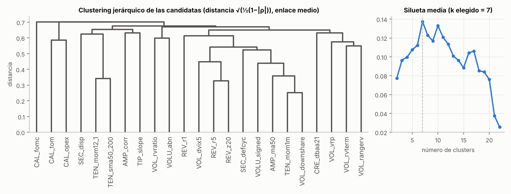
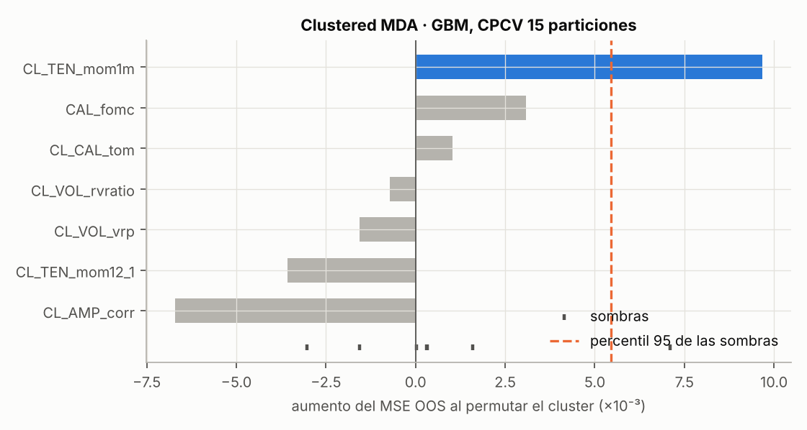
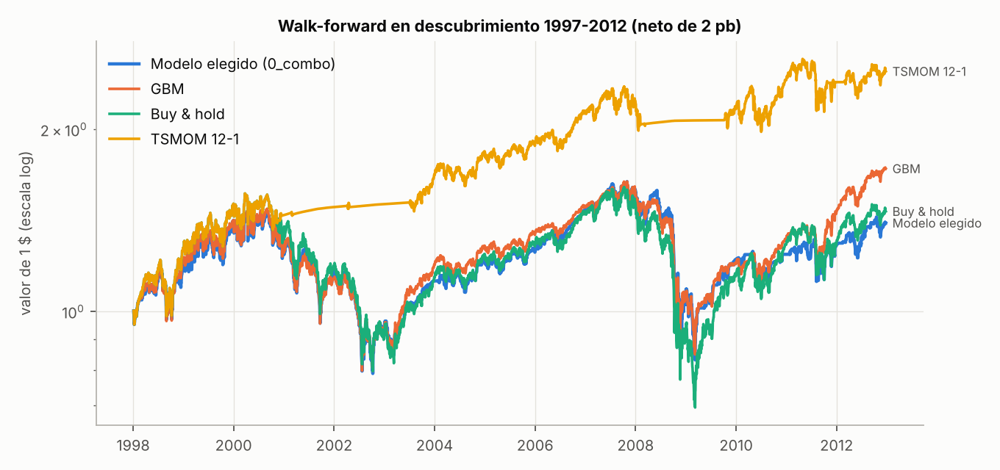
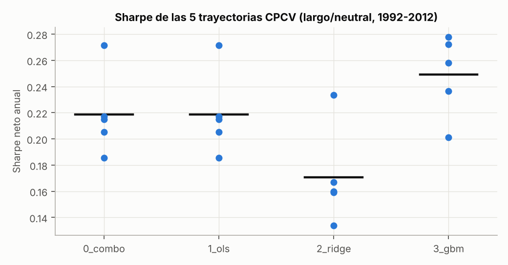
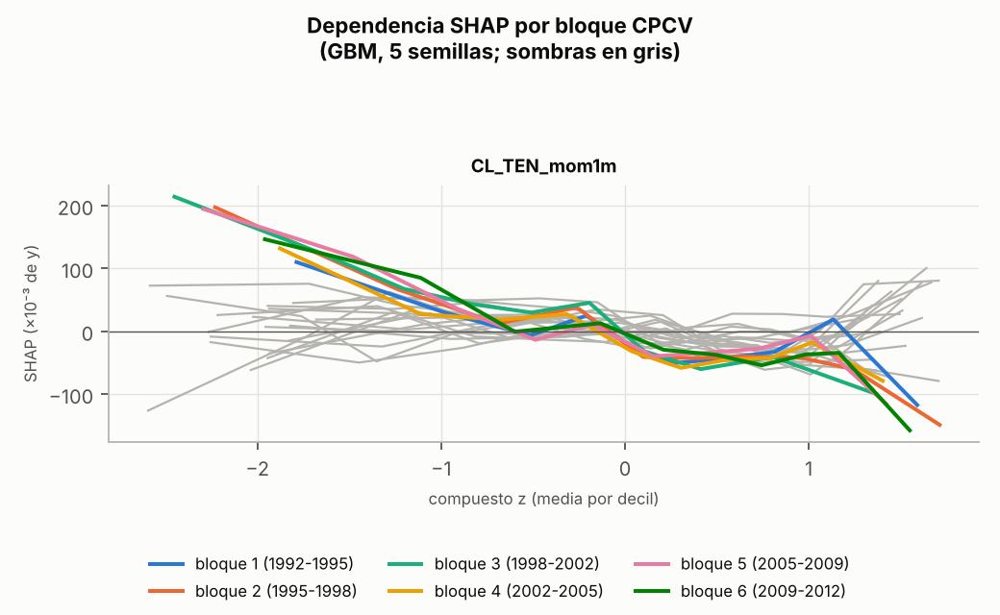

# Línea 1A según la guía del TFM · Características predictivas robustas por estabilidad SHAP

**Versión g1 · descubrimiento 1992-2012 · holdout 2013-2026 sellado y sin abrir**

Este informe sigue la *Guía TFM ML gestión de inversiones, Línea 1 (v26-27, v5)*, sublínea 1.A y su anexo A.
El pre-registro es [`preregistro/preregistro_1A_guia.yaml`](../../../preregistro/preregistro_1A_guia.yaml), con commit
`9de0153` antes de calcular ningún estadístico contra el objetivo. El código está en [`guia1a/`](../../../guia1a) y el
orquestador en [`scripts/run_guia_1a.py`](../../../scripts/run_guia_1a.py).

## Resultado en una frase

**Ninguna característica entra en el catálogo de estables.** Lo que más se acerca es el cluster de movimiento a
corto plazo (reversión a 1-5 días y ΔVIX a 5 días). Sobrevive al clustered MDA, pasa la puerta de skill y su SHAP
tiene el signo esperado en los 6 bloques, con forma estable. Falla por monotonía: el mínimo entre bloques es 0,64 y
el umbral pre-registrado es 0,7. En walk-forward, ningún modelo bate a la media histórica (R² OOS < 0), y el DSR y el
PBO de las variantes son malos. Es un resultado nulo bien documentado, que la guía considera un TFM válido.

## 0 · Datos, muestra y contaminación

| Pieza | Fuente |
| --- | --- |
| S&P 500 OHLC | repositorio de Stefan Jansen `data/equities/market/sp500/sp500.csv` (1980-2025); Yahoo `^GSPC` para el volumen y 2026 |
| VIX, tipo libre de riesgo, crédito, curva | FRED: VIXCLS, DFF, BAA10Y, T10Y3M |
| Sectores y amplitud | Kenneth French, 12 industrias diarias ponderadas por capitalización |
| Calendario | reuniones FOMC programadas (`data_ref/fomc_decision_dates.csv`) |

- **Muestra válida de descubrimiento:** del 3-1-1992 al 21-12-2012, 5.285 sesiones. La guía dice 1990-2012, pero el
  VIX empieza en 1990 y los z-scores expansivos necesitan 252 sesiones de calentamiento.
- **N efectivo:** ≈ T/h = 1.057. Con IC = 0,05 el t esperado es ≈ 1,63, y el error estándar del AUC es ≈ 0,018
  (A.1). Ya se sabía, antes de empezar, que un efecto real de tamaño típico estaría en el límite de la detección.
- **Objetivo:** y = (P[t+5]/P[t] − 1 − rf) / σ₅(t), con σ estimada por EWMA de 60 sesiones conocida en t. Las
  etiquetas se solapan y van ponderadas por unicidad (media 0,200).
- **Test anti look-ahead (A.10):** [`tests/test_lookahead.py`](../../../tests/test_lookahead.py) recorta los datos en
  tres fechas y exige que todo lo anterior salga idéntico. Detectó un fallo real: con el mes incompleto, `CAL_opex`
  marcaba la última sesión disponible como vencimiento. Está corregido antes de cualquier resultado.
- **Holdout sellado:** `datos.cargar()` se niega a leer 2013+ sin una llave explícita.
- **Contaminación declarada.** La línea 1A anterior de este repositorio (v1-v5) usó 1993-2018 como descubrimiento y
  2019-2022 como validación, con candidatas parecidas. Por tanto 2013-2022 ya está visto, y solo 2023-2026 es
  holdout virgen.

## 1 · Fase 1 · Cribado univariante

Tabla completa en [`01_fase1_univariante.csv`](01_fase1_univariante.csv). Las 23 candidatas, con su signo y mecanismo,
están pre-registradas. El criterio es |t_NW| ≥ 2 (10 retardos) con el signo esperado, la métrica real por encima del
percentil 95 de 500 desplazamientos circulares y el mismo signo en al menos el 70 % de los 6 bloques.

| Variable | Signo esp. | t NW | p nulo circular | Bloques con signo | t no solapadas (mín-máx) | t placebo | Pasa |
| --- | :-: | --: | --: | --: | --: | --: | :-: |
| REV_r1 (r diario/σ) | − | −4,40 | 0,000 | 6/6 | −2,9 / 0,1 | −1,75 | ✔ |
| REV_r5 (r 5 días/σ) | − | −4,33 | 0,000 | 6/6 | −3,8 / −2,9 | −2,14 | ✔ |
| VOL_dvix5 (Δlog VIX 5 d) | + | 4,15 | 0,000 | 6/6 | 2,4 / 3,7 | 1,76 | ✔ |
| CAL_tom (cambio de mes) | + | 2,48 | 0,000 | 5/6 | 0,3 / 4,3 | 2,41 | ✔ |
| CAL_fomc (semana FOMC) | + | 2,46 | 0,014 | 5/6 | 1,1 / 2,3 | 2,35 | ✔ |
| REV_z20 | − | −2,34 | 0,010 | 6/6 | −2,4 / −1,1 | 0,36 | ✔ |
| VOL_vrp (prima de varianza) | + | 1,87 | 0,036 | 5/6 | 1,1 / 1,7 | 0,44 | ✘ |
| TEN_mom12_1, TEN_sma50_200 | + | 1,2 | 0,07-0,08 | 3/6 | ~1 | — | ✘ |
| Las 15 restantes | | \|t\| < 1,6 | > 0,13 | | | | ✘ |

Las seis que pasan también sobreviven a Benjamini-Hochberg al 10 %. Tres matices:

- **Placebo.** Para las variables de reversión, controlar por los retornos pasados del índice (r5, r21, r252) es casi
  controlar por ellas mismas. Que REV_z20 caiga a 0,36 indica que su contenido es el de REV_r5. Las dos de calendario
  no cambian con el placebo: no son tendencia disfrazada.
- **No solapadas.** REV_r5 y VOL_dvix5 mantienen |t| ≥ 2,4 en los cinco arranques. CAL_tom y REV_r1 dependen mucho
  del día de arranque.
- **Persistencia.** Tendencia, VRP, pendiente y amplitud tienen AR(1) > 0,9, así que el sesgo de Stambaugh es
  relevante. Ninguna de ellas es significativa de todos modos.

Las estrategias de timing univariantes (largo/neutral, 2 pb por lado) de las que pasan dan un Sharpe neto, en
1992-2012, de 0,47-0,51 (REV_r1, REV_r5, VOL_dvix5 y CAL_fomc), 0,40 (CAL_tom) y 0,26 (REV_z20), frente a 0,23 del
buy & hold. La diferencia con el buy & hold tiene t HAC de 3,4 en REV_r1, 2,6 en VOL_dvix5 y 2,4 en REV_r5. Las de reversión y ΔVIX rotan unas 25 veces al año. Todas
entran en el registro de intentos.

## 2 · Fase 2 · Redundancia, clusters y clustered MDA



- **Clustering.** La regla pre-registrada es la k con máxima silueta. Da 7 clusters, pero con una silueta de solo
  0,14: el criterio de la guía (> 0,5) **no se cumple**, y la estructura de clusters es débil. Los VIF entre
  compuestos son todos menores de 1,12.
- **El cluster de corto plazo** (`CL_TEN_mom1m`) une 9 variables: TEN_mom1m, REV_r5, REV_z20, REV_r1, VOL_dvix5,
  VOL_downshare, VOLU_signed, SEC_defcyc y AMP_ma50. Su compuesto tiene t = −2,68, por debajo de su mejor miembro
  (REV_r1, −4,40). La media de nueve z-scores diluye la señal, y el criterio «compuesto ≥ mejor miembro» tampoco se
  cumple. Es el coste conocido de agrupar a ciegas, y queda documentado.



El clustered MDA usa un GBM con 5 semillas en CPCV de 6 bloques (15 particiones, purga de 5 y embargo de 60), con una
sombra circular por compuesto ([`02_mda.csv`](02_mda.csv)):

| Cluster | ΔMSE medio ×10⁻³ | Particiones con ΔMSE > 0 | ¿> p95 sombras (5,45)? |
| --- | --: | --: | :-: |
| CL_TEN_mom1m (corto plazo) | 9,67 | 14/15 | **sobrevive** |
| CAL_fomc | 3,08 | 15/15 | no |
| CL_CAL_tom | 1,02 | 10/15 | no |
| Resto (tendencia, VRP/crédito, rv-ratio, correlación/pendiente) | < 0 | ≤ 6/15 | no |

Con el ridge el resultado es el mismo: solo sobrevive el cluster de corto plazo, y FOMC queda justo por debajo
(0,61 frente a 0,67). FOMC empeora la pérdida en las 15 particiones, pero no supera a la sombra más fuerte. Con 7
sombras, el percentil 95 está muy cerca de su máximo.

## 3 · Fase 4 · Escalera de modelos, puerta de skill y evaluación

**Puerta de skill** (CPCV, todas las predicciones OOS juntas; GBM con el cluster superviviente):

| Métrica | Valor | Criterio | |
| --- | --: | --- | :-: |
| IC de Spearman | 0,047 | t_NW ≥ 2 → t = 2,24 | ✔ |
| R² OOS frente a la media del entrenamiento | +0,18 % | > 0 | ✔ |
| IC frente a 20 modelos con todo sustituido por sombras | 0,047 | > p95 = −0,008 | ✔ |

**La puerta pasa, aunque por poco.**

**Escalera** ([`04_escalera_comparacion.csv`](04_escalera_comparacion.csv)). Ningún escalón mejora al anterior con
t ≥ 2 en CPCV y en walk-forward a la vez, así que el modelo elegido es el **escalón 0** (combinación de
univariantes). Con una sola variable, la combinación es igual al OLS. Con los 7 compuestos, el GBM empeora al ridge
de forma significativa (t = −2,7 en CPCV y −3,7 en walk-forward). El ridge elige un α tan alto que su predicción es
casi una constante positiva: en walk-forward está siempre largo y equivale al buy & hold.

| Conjunto · modelo | CPCV R² OOS | CPCV CW t | WF R² OOS | WF CW t | WF Sharpe neto | Δ Sharpe vs B&H (t) |
| --- | --: | --: | --: | --: | --: | --: |
| Corto plazo · combo/OLS | +0,29 % | 2,15 | −0,54 % | 0,83 | 0,073 | −0,03 (−0,39) |
| Corto plazo · ridge | +0,13 % | 1,73 | −0,01 % | 0,27 | 0,099 | 0 (siempre largo) |
| Corto plazo · GBM | +0,18 % | 2,48 | −0,98 % | 0,62 | 0,143 | +0,04 (0,73) |
| 7 compuestos · OLS | −0,84 % | 1,30 | −2,12 % | 1,05 | 0,098 | 0,00 |
| 7 compuestos · GBM | −2,30 % | 0,66 | −4,90 % | −0,31 | 0,068 | −0,03 |
| *Buy & hold 1998-2012* | | | | | *0,100* | |
| *TSMOM 12-1 1998-2012* | | | | | *0,320* | |
| *B&H escalado por volatilidad* | | | | | *0,066* | |

El walk-forward es expansivo, con reentreno anual y purga de 5 sesiones. Empieza en 1998 y no en 1997: con el mínimo
de 1.260 sesiones de entrenamiento más la purga, 1997 se queda corto. Es una consecuencia mecánica del pre-registro,
y queda declarada.



- **Lo que dicen las dos validaciones.** El CPCV ve algo de skill: R² ligeramente positivo y Clark-West
  significativo frente a la media del entrenamiento. El walk-forward no lo ve en ningún caso: R² < 0 y Clark-West
  no significativo.
- **La guía avisa de este patrón (A.12).** El CPCV entrena también con el futuro. Un efecto que el CPCV ve y el
  walk-forward no, no se habría podido explotar en tiempo real.
- **Frente a las referencias.** El mejor modelo (GBM) tiene un alfa sobre mercado + TSMOM de +0,9 % anual con
  t = 0,81, y su coste de break-even frente al buy & hold es de 5 pb por unidad de rotación. TSMOM 12-1 domina a
  todos los modelos en 1998-2012, sobre todo porque esquiva 2001-2002 y 2008.



En CPCV, las 5 trayectorias del GBM dan un Sharpe de 0,20-0,28 en 1992-2012, con un buy & hold de 0,23 en el mismo
periodo. La dispersión entre trayectorias es pequeña, pero el nivel no supera al buy & hold.

## 4 · Estabilidad SHAP (A.6)



El modelo es un GBM con el compuesto superviviente y 3 sombras circulares, 5 semillas y TreeSHAP interventional con
500 observaciones de fondo, calculado en el bloque de prueba. Se obtiene una curva por bloque, como media de las 5
particiones en que ese bloque es de prueba ([`05_estabilidad_shap.csv`](05_estabilidad_shap.csv)).

| Propiedad | Valor | Umbral | p95 de las sombras | |
| --- | --: | --: | --: | :-: |
| Signo (Spearman x-SHAP) | − en los 6 bloques | el esperado (−) en todos | — | ✔ |
| Monotonía, mínimo de \|ρ\| | **0,64** | ≥ 0,7 | 0,27 | **✘** |
| Forma, correlación media entre curvas | 0,92 | ≥ 0,7 | 0,69 | ✔ |
| Relevancia, media de \|SHAP\| | 0,062 | > p95 | 0,039 | ✔ |
| Ridge: signo del coeficiente | negativo en las 15 particiones | constante | — | ✔ |

La figura muestra por qué falla la monotonía. La curva es claramente decreciente en las colas (caídas fuertes →
rebote; subidas fuertes → retroceso) y casi plana entre −0,5 y +1. Es un efecto de colas, no lineal. Supera de largo
a las sombras en todo, pero no llega al umbral absoluto de 0,7 en el peor bloque. Por la regla pre-registrada queda
**descartada**. La guía advierte de que los umbrales son convenciones, pero lo importante es no moverlos después de
mirar.

## 5 · Fase 3 · Regímenes (A.12)

El modelo principal es el ridge. M1 es el compuesto de corto plazo; M2 añade RV20, VIX, tendencia (P > SMA200) y
drawdown de 252 sesiones; M3 añade las dos interacciones por hipótesis ([`06_regimen_comparacion.csv`](06_regimen_comparacion.csv)).

| Paso | ΔR² CPCV (t) | ΔR² WF (t) | Folds CPCV con mejora | ¿> p95 sombras? | Acepta |
| --- | --: | --: | --: | :-: | :-: |
| M1 → M2 (regímenes directos) | −0,14 % (−4,2) | −0,23 % (−2,2) | 2/15 | no | ✘ |
| M2 → M3 (interacciones) | −0,02 % (−0,7) | +0,15 % (1,3) | 3/15 | no | ✘ |
| GBM aditivo → con interacción permitida | −0,14 % (−1,0) | −0,37 % (−2,2) | 4/15 | — | ✘ |

Los coeficientes de interacción tampoco salen, y los dos tienen el signo contrario al esperado:

- **r5 × RV20:** d = +0,013 (t = 0,57).
- **ΔVIX × VIX:** d = −0,007 (t = −0,32).

**No se incorpora ningún régimen.** Como anticipa la guía, el escalado del objetivo por volatilidad ya absorbe la
heterogeneidad que podría haber.

## 6 · Sobreajuste: DSR y PBO

En el registro hay 36 intentos con su serie diaria OOS ([`registro_intentos.csv`](registro_intentos.csv),
[`series_oos/`](series_oos)), más 4 referencias ([`07_dsr_pbo.json`](07_dsr_pbo.json)).

| Matriz (1998-2012, CSCV S = 16) | Variantes | PBO | DSR del líder | Líder |
| --- | --: | --: | --: | --- |
| Modelos en walk-forward | 13 | **0,72** | 0,81 | GBM, corto plazo (Sharpe 0,14) |
| Modelos + reglas univariantes | 35 | 0,34 | 0,95 | timing FOMC (Sharpe 0,47) |

- **Modelos en walk-forward.** Un PBO de 0,72 significa que elegir el mejor dentro de muestra lleva casi siempre a
  uno peor que la mediana fuera de muestra. Ningún modelo cumple PBO < 0,2 ni DSR > 0,95.
- **La regla FOMC** (estar largo solo en las ventanas de 5 sesiones que contienen una decisión del FOMC) alcanza
  justo el DSR de 0,95 (0,952). Es una regla sin parámetros y con el signo pre-registrado, pero tiene dos debilidades. No sobrevive al
  clustered MDA frente a las sombras. Y el drift pre-FOMC se publicó con datos de 1994-2011 (Lucca y Moench, 2015),
  así que no es evidencia independiente. Queda como candidata para el holdout, no como hallazgo.

## 7 · Catálogo de variables

Catálogo completo con el motivo de cada decisión: [`08_catalogo.csv`](08_catalogo.csv).

| Grupo | Variables | Fase 1 | MDA | SHAP | Decisión y motivo | Lectura A.6 |
| --- | --- | :-: | :-: | :-: | --- | --- |
| Corto plazo | REV_r5, REV_r1, REV_z20, VOL_dvix5 | ✔ | ✔ | ✘ | descartada: monotonía mínima 0,64 < 0,7 | probable proxy* |
| Corto plazo (resto) | TEN_mom1m, VOL_downshare, VOLU_signed, SEC_defcyc, AMP_ma50 | ✘ | ✔ | ✘ | descartada: arrastradas por el cluster, sin efecto propio | sin efecto |
| Calendario | CAL_fomc, CAL_tom | ✔ | ✘ | — | descartada: ΔMSE positivo pero ≤ p95 de las sombras | probable proxy* |
| Calendario | CAL_opex | ✘ | ✘ | — | descartada (MDA) | sin efecto |
| Tendencia | TEN_mom12_1, TEN_sma50_200, SEC_disp | ✘ | ✘ | — | descartada (MDA) | sin efecto |
| Volatilidad y crédito | VOL_vrp, VOL_rvterm, VOL_rangerv, CRE_dbaa21, VOL_rvratio, VOLU_abn | ✘ | ✘ | — | descartada (MDA) | sin efecto |
| Amplitud y tipos | AMP_corr, TIP_slope | ✘ | ✘ | — | descartada (MDA) | sin efecto |

\* La tabla de A.6 llama «probable proxy» al caso univariante Sí / SHAP No. Aquí la causa no es que otra variable
absorba el efecto. En el corto plazo es el umbral de monotonía; en calendario, el filtro del MDA.

## 8 · Conclusiones y siguientes pasos

1. **Resultado nulo bajo el pre-registro.** Ninguna característica cumple la cadena completa: fase 1 → MDA → puerta
   de skill → SHAP estable → walk-forward → DSR/PBO. Es coherente con Welch y Goyal (2008) y con el N efectivo ≈ 1.000
   calculado al principio.
2. **Lo más sólido es la reversión a muy corto plazo con rebote tras picos de VIX.** Es significativa sola, estable de
   signo y forma en los 6 bloques y fuerte frente a las sombras. Pero es un efecto de colas: falla la monotonía, y en
   tiempo real (walk-forward) no bate a la media histórica.
3. **El clustering pre-registrado fue un mal compañero.** Con una silueta de 0,14, la regla de máxima silueta metió
   nueve variables en un compuesto que diluye la señal. Una reapertura natural, que contaría como versión nueva y
   como intentos adicionales, es exigir silueta > 0,5 o cortar por distancia, y separar reversión de ΔVIX.
4. **El holdout 2013-2026 sigue sellado.** [`scripts/holdout_guia_1a.py`](../../../scripts/holdout_guia_1a.py) lo
   ejecuta una sola vez con el pipeline congelado: el cluster superviviente, la combinación y el GBM, frente al buy &
   hold, TSMOM y el B&H escalado por volatilidad. Reporta por separado 2013-2022 (contaminado) y 2023-2026 (virgen),
   y deja una marca que impide repetirlo.

## Reproducir

```bash
git clone --depth 1 --filter=blob:limit=200m --sparse https://github.com/stefan-jansen/machine-learning-for-trading.git ../ml4t/machine-learning-for-trading
(cd ../ml4t/machine-learning-for-trading && git sparse-checkout set data)
pip install -r requirements.txt pytest
python -m pytest -q tests/test_lookahead.py
python scripts/run_guia_1a.py todo        # unos 8 minutos con 4 núcleos (SHAP con 500 de fondo, unos 5)
GUIA1A_HOLDOUT=ABRIR-HOLDOUT-UNA-SOLA-VEZ python scripts/holdout_guia_1a.py   # solo al final, una vez
```
