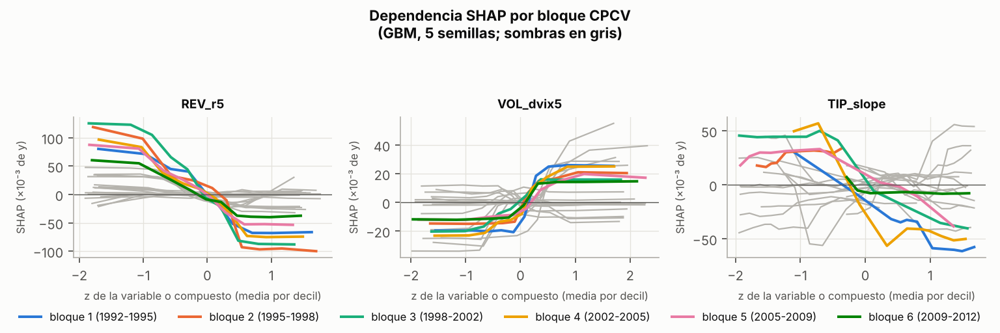
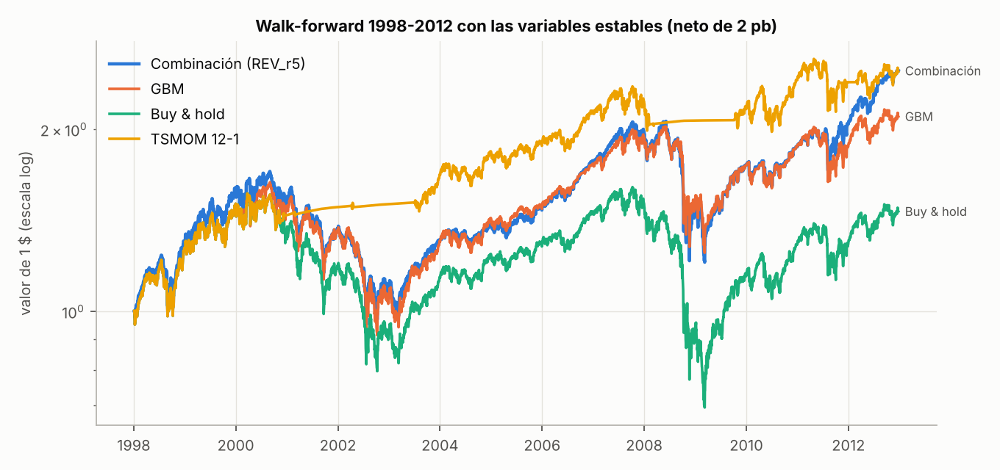

# Línea 1A según la guía · versión g3: variables individuales

> **Holdout abierto el 2026-11-20 ([informe](holdout/INFORME_HOLDOUT.md)): REV_r5 no se confirma.** Mantiene el
> signo en 2013-2026, pero su pendiente encoge un 57 % y no es significativa. El modelo elegido no bate a la media
> histórica (R² −0,12 %), y la estrategia queda por debajo del buy & hold (Sharpe 0,56 frente a 0,69).

**Tercera versión, reapertura declarada de g2** ([informe g1](../g1/INFORME_1A_guia.md),
[informe g2](../g2/INFORME_1A_guia_g2.md)). Se escribió después de ver g1 y g2, a petición del autor. El pre-registro
es [`preregistro/preregistro_1A_guia_g3.yaml`](../../../preregistro/preregistro_1A_guia_g3.yaml), con commit
`5527df9` antes de ejecutar.

**Único cambio frente a g2: no hay compuestos.** Cada una de las 23 candidatas entra sola al clustered MDA (se
permuta sola, con su propia sombra), a la puerta de skill, a la estabilidad SHAP (3 sombras por variable) y a los
regímenes. El GBM es el de g2: early stopping y rejilla de mínimo por hoja. La fase 1 es idéntica.

- **Motivo del cambio:** en g1 y g2, la regla de máxima silueta dio una silueta de 0,14 (la guía pide > 0,5). Metió
  la reversión a 5 días en un compuesto de 9 variables que diluía su señal: t −2,68 frente a −4,40 del mejor miembro.
- **Riesgo declarado:** los pares muy correlacionados pueden repartirse el crédito en el MDA y el SHAP (Aas, Jullum y
  Løland, 2021), por ejemplo REV_r5 con REV_z20 (|ρ| 0,79) o con VOL_dvix5 (0,70).

## Resultado

**Por primera vez una variable entra en el catálogo de estables: REV_r5**, el retorno de las últimas 5 sesiones
dividido por la volatilidad, con efecto negativo (reversión). Además, en walk-forward bate a la media histórica y al
buy & hold. **No cumple todavía la lista completa de A.11:** el DSR (0,92) y el PBO (0,22) no alcanzan los umbrales,
y falta el holdout.

## 1 · Clustered MDA con variables individuales

GBM con 5 semillas en CPCV de 15 particiones y una sombra por variable; el p95 de las 23 sombras es 0,19×10⁻³
([`02_mda.csv`](02_mda.csv)).

| Variable | ΔMSE ×10⁻³ | Particiones con ΔMSE > 0 | Sobrevive |
| --- | --: | --: | :-: |
| REV_r5 | 6,16 | 15/15 | ✔ |
| VOL_dvix5 | 0,67 | 14/15 | ✔ |
| TIP_slope | 0,45 | 10/15 | ✔ |
| VOL_vrp | 0,13 | 7/15 | ✘ |
| REV_r1, REV_z20, CAL_fomc, CAL_tom y el resto | ≤ 0,05 | | ✘ |

- **REV_r1 y REV_z20 no sobreviven** aunque son significativas solas (t −4,40 y −2,34). Con REV_r5 en el modelo, su
  información es redundante y permutarlas no empeora nada: es el reparto de crédito que se había declarado como
  riesgo.
- **TIP_slope (pendiente de la curva) sobrevive** sin tener efecto univariante (t −0,95). Es muy persistente (AR(1)
  0,998), y un GBM puede usarla para separar épocas. El SHAP con sombras la descarta después (sección 3).
- **Sensibilidad con ridge** (no decide): sobreviven REV_r5, VOL_dvix5, REV_z20, REV_r1, VOL_vrp, CAL_fomc, CAL_tom y
  AMP_ma50.

## 2 · Puerta de skill y escalera

**Puerta de skill:** pasa con holgura. El GBM con los tres supervivientes da en CPCV un IC de 0,076 (t 3,19) y un
R² OOS de +0,71 %, frente a un p95 de las sombras de −0,013. En g1 el IC era 0,047 (t 2,24) y en g2, 0,025 (t 1,17).

**Escalera con los tres supervivientes:** ningún escalón mejora al anterior en CPCV y walk-forward a la vez; el
elegido es la combinación ([`04_escalera_comparacion.csv`](04_escalera_comparacion.csv)). La combinación ya da en
walk-forward un R² de +0,41 % (Clark-West t 2,13) y un Sharpe de 0,17.

**Rejilla de mínimo por hoja** ([`04_gbm_rejilla_min_child.csv`](04_gbm_rejilla_min_child.csv)):

- **En CPCV,** todos los valores dan un IC significativo (t de 2,4 a 3,7).
- **En walk-forward,** el R² solo es positivo con 200, 400 y 800, y Clark-West nunca pasa de t 1,72.
- **La mediana de árboles elegidos** por early stopping es 22 en walk-forward y 93 en CPCV.

## 3 · Estabilidad SHAP



GBM con los 3 supervivientes y 3 sombras por variable, 5 semillas, TreeSHAP interventional con 500 observaciones de
fondo ([`05_estabilidad_shap.csv`](05_estabilidad_shap.csv)).

| Variable | Signo en los 6 bloques | Monotonía mín. (p95 sombras) | Forma (p95 sombras) | Relevancia (p95 sombras) | Ridge: signo en 15 particiones | Decisión |
| --- | --- | --: | --: | --: | --- | --- |
| **REV_r5** | − − − − − − ✔ | **0,93** (0,90) ✔ | **0,98** (0,94) ✔ | **0,054** (0,022) ✔ | negativo en 15/15 ✔ | **estable** |
| VOL_dvix5 | + + + + + + ✔ | 0,75 (0,90) ✘ | 0,96 (0,94) ✔ | 0,016 (0,022) ✘ | positivo en 15/15 ✔ | descartada |
| TIP_slope | − + − − − − ✘ | 0,42 ✘ | 0,17 ✘ | 0,032 ✔ | inestable ✘ | descartada |

- **REV_r5 tiene el perfil que busca la sublínea 1.A.** En los 6 bloques, la curva SHAP es decreciente y monótona:
  tras caídas fuertes de 5 días el modelo espera rebote, y tras subidas fuertes, retroceso. Ya no es solo un efecto
  de colas, como parecía con el compuesto de g1.
- **El umbral de las sombras fue exigente.** El p95 conjunto de monotonía es 0,90, empujado por las sombras de
  TIP_slope: una variable persistente desplazada da curvas suaves. REV_r5 lo supera de todos modos.
- **VOL_dvix5 tiene el signo y la forma correctos en todos los bloques.** Con REV_r5 en el mismo modelo (ρ −0,70),
  su crédito SHAP condicional es pequeño y no supera a las sombras. Según la tabla de A.6 es un **probable proxy**:
  buena parte de su efecto lo recoge REV_r5.
- **TIP_slope cambia de signo** en el bloque 2 y no tiene forma estable. Su paso por el MDA era un artefacto: separaba
  épocas, no predecía.

## 4 · Walk-forward con la variable estable (A.6, paso 4)

La guía cierra el proceso con un walk-forward usando solo las variables estables. Aquí es REV_r5 sola
([`09_walk_forward_estables.json`](09_walk_forward_estables.json)): expansivo, reentreno anual, purga de 5 sesiones,
1998-2012, estrategia largo/neutral con 2 pb por lado.

| Modelo | CPCV IC (t) | WF R² OOS | WF Clark-West t | WF Sharpe neto | Δ Sharpe vs B&H (t HAC) | Alfa vs mercado + TSMOM (t) | Rotación |
| --- | --: | --: | --: | --: | --: | --: | --: |
| **Combinación = OLS** | 0,099 (4,07) | **+0,36 %** | **2,49** | **0,28** | **+0,18 (2,48)** | **+3,4 %/año (2,63)** | 22/año |
| Ridge | 0,069 (2,71) | +0,29 % | 1,66 | 0,11 | +0,01 (0,26) | +0,05 % (0,08) | 5/año |
| GBM | 0,088 (3,72) | −0,04 % | 1,62 | 0,22 | +0,12 (1,77) | +2,1 % (1,70) | 14/año |
| *Buy & hold* | | | | *0,10* | | | |
| *TSMOM 12-1* | | | | *0,32* | | | |
| *B&H escalado por volatilidad* | | | | *0,07* | | | |



- **La regresión lineal con REV_r5 sola cumple el criterio de A.5 y A.11.5.** Su R² fuera de muestra es positivo
  (+0,36 %, de la escala relevante en datos diarios según Campbell y Thompson) y Clark-West es significativo frente a
  la media histórica.
- **Valor económico:** Sharpe neto de 0,28 frente a 0,10 del buy & hold, con diferencia significativa (t 2,48). El
  alfa sobre mercado + TSMOM es del 3,4 % anual (t 2,63), así que **aporta frente a la tendencia** aunque su Sharpe
  (0,28) sea algo menor que el de TSMOM (0,32).
- **Costes:** el coste de break-even frente al buy & hold es de 15 pb por unidad de rotación. El supuesto de 2 pb es
  7 veces menor, y la guía pide al menos 2-3 veces.
- **Drawdown:** −44 %, frente a −57 % del buy & hold. La mejora más visible es 2008-2009.
- **Ridge y GBM aportan menos que el lineal sin penalizar.** El ridge encoge demasiado y el GBM no mejora la forma
  lineal, así que se queda la regresión lineal (A.5: «si el GBM no mejora al ridge, se queda el ridge»; aquí, el
  lineal).

## 5 · Regímenes

No se acepta ninguno ([`06_regimen_comparacion.csv`](06_regimen_comparacion.csv)):

| Paso | ΔR² CPCV (t) | ΔR² WF (t) | Decisión |
| --- | --: | --: | :-: |
| M1 → M2 (regímenes directos) | −0,24 pp (t −4,8) | −0,34 pp (t −1,7) | ✘ |
| M2 → M3 (interacciones) | −0,06 pp (t −2,9) | +0,11 pp (t 0,7) | ✘ |

Las interacciones r5 × RV20 y ΔVIX × VIX siguen sin efecto, como en g1.

## 6 · Sobreajuste con todo lo probado (g1 + g2 + g3)

61 intentos únicos; las series idénticas entre versiones cuentan una vez ([`07_dsr_pbo.json`](07_dsr_pbo.json)).

| Matriz 1998-2012 | Variantes | PBO | DSR del líder | Líder |
| --- | --: | --: | --: | --- |
| Modelos en walk-forward | 38 | **0,22** (g1: 0,72; g2: 0,80) | **0,92** | combinación con REV_r5 (Sharpe 0,28) |
| Modelos + reglas univariantes | 60 | 0,35 | 0,98 | regla FOMC (Sharpe 0,47) |

- **Mejora mucho frente a g1 y g2,** pero no alcanza los criterios: PBO < 0,1-0,2 y DSR > 0,95. Con 61 intentos, un
  Sharpe de 0,28 en 15 años no basta para descartar del todo la suerte de selección.
- **La regla FOMC** sigue con el DSR más alto, con las mismas reservas de g1: no pasa el MDA, y su efecto se publicó
  con datos de este mismo periodo.

## 7 · Catálogo g3

Catálogo completo en [`08_catalogo.csv`](08_catalogo.csv).

| Variable | Fase 1 | MDA | SHAP | Decisión | Lectura A.6 |
| --- | :-: | :-: | :-: | --- | --- |
| **REV_r5** | ✔ | ✔ | ✔ | **estable** | efecto propio y robusto |
| VOL_dvix5 | ✔ | ✔ | ✘ (relevancia y monotonía frente a sombras) | descartada | probable proxy de REV_r5 |
| REV_r1, REV_z20 | ✔ | ✘ | — | descartada | redundantes con REV_r5 |
| CAL_fomc, CAL_tom | ✔ | ✘ | — | descartada | sin aporte condicional |
| TIP_slope | ✘ | ✔ | ✘ (signo y forma) | descartada | artefacto de persistencia |
| Las 17 restantes | ✘ | ✘ | — | descartada | sin efecto |

## 8 · Lista de A.11 para REV_r5

| # | Criterio de la guía | Resultado | |
| --: | --- | --- | :-: |
| 1 | Significativa con Newey-West, robusta a persistencia, corregida por intentos | t −4,33; no solapadas −2,9 a −3,8; AR(1) 0,77; el DSR con 61 intentos es 0,92 | ✔ / ✘ |
| 2 | Estable en el tiempo y por encima del nulo circular | signo en 6/6 bloques; p nulo 0,000 | ✔ |
| 3 | Sobrevive al clustered MDA | ΔMSE positivo en 15/15 particiones, muy por encima de las sombras | ✔ |
| 4 | Puerta de skill y SHAP estable frente a sombras | IC 0,076 (t 3,19); signo, monotonía, forma y relevancia ✔ | ✔ |
| 5 | Bate a la media histórica y aporta frente a TSMOM | R² WF +0,36 %, Clark-West t 2,49; alfa sobre TSMOM t 2,63 | ✔ |
| 6 | Valor económico neto de costes | Sharpe 0,28 frente a 0,10 (t 2,48); break-even 15 pb | ✔ |
| 7 | Robusta: PBO bajo, DSR alto | PBO 0,22; DSR 0,92 | ✘ (por poco) |
| 8 | Se confirma en el holdout y tiene mecanismo | mecanismo: provisión de liquidez (Nagel, 2012); holdout: mismo signo, pero encoge un 57 %, no es significativo y no bate al buy & hold | ✘ |

## 9 · Advertencias para la memoria del TFM

1. **Es la tercera versión.** g3 se escribió después de ver g1 y g2. Las razones están declaradas y son metodológicas
   (silueta 0,14, criterio de la guía no cumplido), pero es un camino que se bifurca: por eso el DSR y el PBO cuentan
   los 61 intentos de las tres versiones.
2. **El walk-forward de 1998-2012 no es independiente.** La selección (MDA y SHAP) usó todo el descubrimiento, así
   que este walk-forward es optimista. La prueba independiente es el holdout.
3. **REV_r5 tampoco es nueva para el autor.** La línea 1A anterior del repositorio (`linea1a/`, F01) usó la misma
   variable con datos de 1993-2018. De ahí que la parte limpia del holdout sea 2023-2026.
4. **El efecto es conocido en la literatura** (reversión semanal del índice, provisión de liquidez). Esto refuerza el
   mecanismo, pero también hace probable que se haya debilitado tras su publicación.

## Conclusión

Con variables individuales, el proceso de la guía identifica **una característica estable: la reversión a 5 días
escalada por volatilidad (REV_r5)**.

- **Cumple 6 de los 8 puntos de A.11.** Tiene efecto marginal y condicional estable en los 6 bloques frente a
  sombras, y en walk-forward bate a la media histórica (Clark-West t 2,5) y al buy & hold neto de costes (t 2,5),
  con alfa sobre TSMOM.
- **Le falta robustez al sobreajuste** (DSR 0,92 < 0,95; PBO 0,22 > 0,2) **y la confirmación en el holdout.**

El siguiente paso que propone la guía es ejecutar el holdout una sola vez con este pipeline congelado:
`scripts/holdout_guia_1a.py` con `GUIA1A_PREREG=preregistro/preregistro_1A_guia_g3.yaml`. El criterio es mismo
signo y una magnitud dentro del intervalo del descubrimiento (un encogimiento del 30-50 % es normal), con la lectura
principal en 2023-2026.

## Reproducir

```bash
export GUIA1A_PREREG=preregistro/preregistro_1A_guia_g3.yaml TQDM_DISABLE=1
python scripts/run_guia_1a.py todo       # unos 20 minutos con 4 núcleos
python scripts/run_guia_1a.py estables   # walk-forward con las variables del catálogo
python scripts/run_guia_1a.py sobreajuste
```
