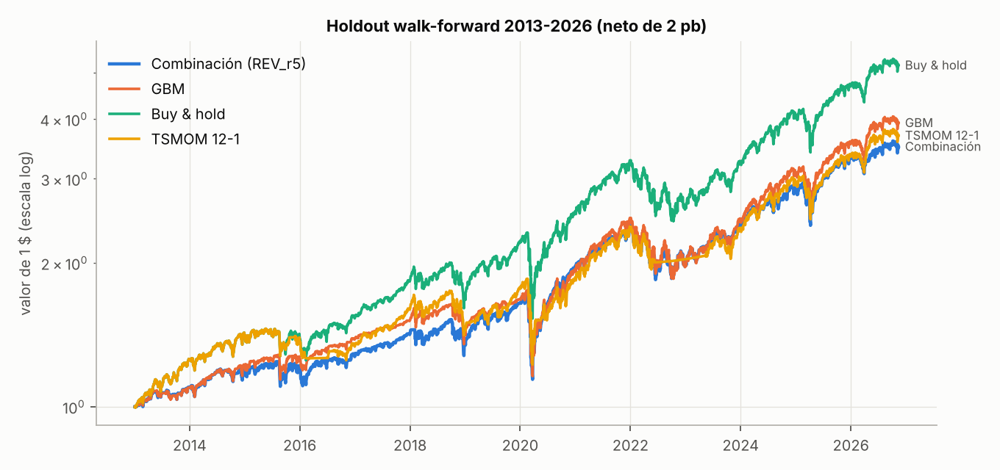

# Holdout 2013-2026 · línea 1A g3 · REV_r5

**Ejecución única**, abierta el 2026-11-20 a las 22:29 UTC con el pipeline g3 congelado (marca en [`ABIERTO`](ABIERTO)).

- **Código:** `scripts/holdout_guia_1a.py`, commit `31899a1`, probado antes en seco sobre el descubrimiento.
- **Pre-registro:** `preregistro_1A_guia_g3.yaml`, SHA-256 `d6cd3c04…`.
- **Variable:** REV_r5, la única estable del catálogo g3.
- **Modelos:** la combinación (= OLS con una variable), que es el elegido por la escalera, y el GBM con early stopping
  y rejilla de mínimo por hoja.
- **Esquema:** walk-forward expansivo desde 1992, reentreno cada 1 de enero, purga de 5 sesiones. Estrategia
  largo/neutral en 5 tramos, con 2 pb por lado.
- **Datos:** hasta el 18-11-2026 (última etiqueta completa: 11-11-2026).

## Criterio de la guía (Fase 5)

> Mismo signo; magnitud dentro del intervalo del descubrimiento (es normal que encoja un 30-50 %); DSR aceptable.

### 1 · El efecto: pendiente de y sobre REV_r5 ([`holdout_pendiente.csv`](holdout_pendiente.csv))

Descubrimiento 1992-2012: b = −0,110 (t NW −4,33), con intervalo del 95 % [−0,160, −0,060].

| Periodo | Sesiones | b | t NW | b holdout / b descubrimiento | ¿Mismo signo? | ¿Dentro del IC 95 % del descubrimiento? |
| --- | --: | --: | --: | --: | :-: | :-: |
| 2013-2026 | 3.480 | −0,048 | −1,65 | 0,43 (encoge 57 %) | ✔ | ✘ |
| 2013-2022 (contaminado) | 2.511 | −0,041 | −1,21 | 0,38 (encoge 62 %) | ✔ | ✘ |
| **2023-2026 (virgen)** | 969 | −0,064 | −1,18 | 0,58 (encoge 42 %) | ✔ | ✔ |

- **El signo se mantiene en todos los periodos.**
- **La magnitud cae más de lo que la guía considera normal** en el holdout completo: encoge un 57 % y queda fuera
  del intervalo del descubrimiento. En el tramo virgen el encogimiento sí está dentro de lo normal (42 %), pero solo
  hay unas 190 observaciones independientes y no es significativo (t −1,18).
- Ningún tramo del holdout es significativo por sí solo.

### 2 · Predicción fuera de muestra ([`holdout_metricas.csv`](holdout_metricas.csv))

| Periodo | Modelo | R² OOS vs media histórica | Clark-West t | IC (t) |
| --- | --- | --: | --: | --: |
| 2013-2026 | Combinación | −0,12 % | 1,47 | 0,053 (1,91) |
| 2013-2026 | GBM | +0,26 % | **2,42** | 0,054 (2,08) |
| 2013-2022 | Combinación | −0,27 % | 1,04 | 0,044 (1,35) |
| 2013-2022 | GBM | +0,23 % | 2,19 | 0,053 (1,78) |
| 2023-2026 | Combinación | +0,33 % | 1,21 | 0,077 (1,43) |
| 2023-2026 | GBM | +0,34 % | 1,27 | 0,086 (1,83) |

Queda un contenido predictivo débil, con IC positivo en todos los tramos. El GBM bate a la media histórica en
2013-2026 (Clark-West t 2,42), pero **el modelo elegido en el descubrimiento (la combinación) no**: R² −0,12 % y
Clark-West t 1,47, por debajo de 1,645.

### 3 · Valor económico

| Periodo | Estrategia | Sharpe neto | Δ Sharpe vs B&H (t HAC) | Alfa vs mercado + TSMOM (t) | Drawdown máx. | Rotación |
| --- | --- | --: | --: | --: | --: | --: |
| 2013-2026 | Combinación (REV_r5) | 0,56 | −0,12 (−1,66) | −1,4 %/año (−1,24) | −33 % | 21/año |
| 2013-2026 | GBM | 0,59 | −0,09 (−1,54) | −1,2 %/año (−1,24) | −34 % | 12/año |
| 2013-2026 | *Buy & hold* | *0,69* | | | *−34 %* | |
| 2013-2026 | *TSMOM 12-1* | *0,59* | | | *−34 %* | |
| 2023-2026 | Combinación | 0,83 | −0,13 (−0,95) | −1,1 %/año (−0,62) | −19 % | 20/año |
| 2023-2026 | GBM | 0,96 | 0 (siempre invertido) | 0 | −19 % | 0 |
| 2023-2026 | *Buy & hold* | *0,96* | | | *−19 %* | |

**La estrategia no bate al buy & hold en ningún tramo.**

- **Año a año** ([`holdout_anual.csv`](holdout_anual.csv)), la combinación solo gana al buy & hold en 5 de 14 años:
  2015, 2018, 2020, 2022 y 2025. Son años de caídas o de mucha volatilidad, en los que el rebote tras las caídas
  ayuda.
- **En los años alcistas pierde.** Está en liquidez cerca del 30 % del tiempo, normalmente tras subidas fuertes, y en
  un mercado que sube de forma sostenida esas salidas cuestan más de lo que aportan los rebotes.
- **El GBM en 2023-2026** predice siempre un retorno positivo y no sale nunca del mercado: es el buy & hold.
- **TSMOM 12-1,** la referencia de tendencia, también pierde frente al buy & hold en este periodo (0,59 frente a
  0,69).

### 4 · Veredicto

| Criterio de la Fase 5 | Resultado | |
| --- | --- | :-: |
| Mismo signo | sí, en los tres tramos | ✔ |
| Magnitud dentro del intervalo del descubrimiento | no en 2013-2026 (encoge 57 %); sí en 2023-2026 (42 %), pero no significativa | ✘ / límite |
| Bate a la media histórica (modelo elegido) | no: R² −0,12 %, Clark-West t 1,47 | ✘ |
| Valor económico frente al buy & hold | no: Sharpe 0,56 frente a 0,69; alfa negativo | ✘ |

**REV_r5 no se confirma en el holdout como característica predictiva con valor económico.**

- **Lo que sí se mantiene es la dirección:** después de una semana alcista, el retorno de la siguiente tiende a ser
  algo menor, y al revés. Su tamaño es menos de la mitad del estimado en 1992-2012 y no es significativo por sí solo.
- **Es lo que la literatura sobre predictibilidad lleva a esperar:** un efecto publicado y conocido se debilita, y
  2013-2026 es un mercado alcista con pocas caídas, que penaliza cualquier regla que salga del mercado tras subidas.

## Notas de transparencia

1. **Figura y series diarias regeneradas.** En la ejecución única, la figura y el parquet guardaban por error la serie
   del último subperiodo (2023-2026) en lugar de la completa. Las métricas no se vieron afectadas. Se corrigió el
   guardado y se regeneraron con el mismo cálculo determinista en un directorio aparte. Antes de copiar nada se
   comprobó que las tres tablas de métricas coincidían exactamente con las de la ejecución única. No se cambió nada
   que afecte a los resultados.
2. **2013-2022 estaba contaminado** por la línea 1A anterior del repositorio (descubrimiento 1993-2018 y validación
   2019-2022). La lectura limpia es 2023-2026: mismo signo, encogimiento normal, no significativo y sin valor
   económico.
3. **El holdout ya no lo es.** Cualquier versión posterior que use estos resultados para decidir cuenta como un
   intento más, y deja de tener un periodo fuera de muestra virgen.
