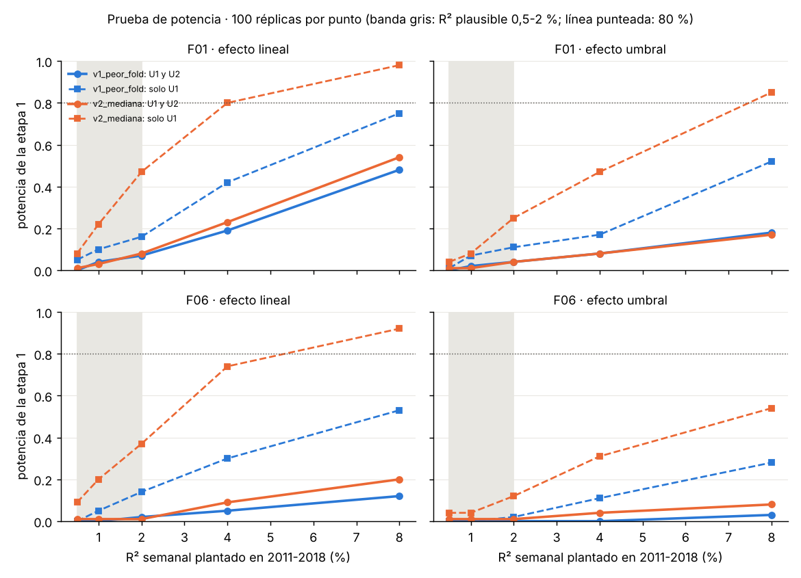

# Prueba de potencia de la etapa 1

`scripts/potencia.py`, 2026-10-25. Datos sintéticos: no usa el retorno real y no suma en `trials.jsonl`.

## Diseño

- **Base sin señal**: y desplazado circularmente en descubrimiento (misma distribución y autocorrelación que el
  retorno real, sin relación con X). Un desplazamiento distinto por réplica.
- **Efecto plantado**: y* = y_sombra + β·g(x) sobre una candidata real, para conservar su persistencia y su
  distribución: **F01** (reversión, sin persistencia) y **F06** (VRP, AR(1) ≈ 0,6, colas gruesas).
- **Formas**: lineal (g = x estandarizada) y umbral (g = 1[x > p70]).
- **Tamaño**: β calibrado para que g explique un R² semanal dado **en los bloques de test 2011-2018**
  (0,5 %, 1 %, 2 %, 4 %, 8 %). En predicción de índices lo plausible es 0,5-2 %.
- **Criterios**: etapa 1 de la v1 (peor fold) y de la v2 (mediana), con 200 sombras por réplica y
  **100 réplicas por celda**. Potencia = fracción de réplicas en que la variable plantada pasa global (U1 > q1 y U2 > q2).

## Resultados

Tasa de falsos positivos sin efecto plantado: v1 0/100, v2 1/100 (q1 medio 0,88 y 1,86, como en los datos reales).

| Variable | Forma | R² | Potencia v1 | Potencia v2 | Solo U1 v1 | Solo U1 v2 |
| --- | --- | --- | --- | --- | --- | --- |
| F01 | lineal | 0,5 % | 0 % | 1 % | 5 % | 8 % |
| F01 | lineal | 1 % | 4 % | 3 % | 10 % | 22 % |
| F01 | lineal | 2 % | 7 % | 8 % | 16 % | 47 % |
| F01 | lineal | 4 % | 19 % | 23 % | 42 % | 80 % |
| F01 | lineal | 8 % | 48 % | 54 % | 75 % | 98 % |
| F01 | umbral | 2 % | 4 % | 4 % | 11 % | 25 % |
| F01 | umbral | 8 % | 18 % | 17 % | 52 % | 85 % |
| F06 | lineal | 1 % | 0 % | 1 % | 5 % | 20 % |
| F06 | lineal | 2 % | 2 % | 1 % | 14 % | 37 % |
| F06 | lineal | 4 % | 5 % | 9 % | 30 % | 74 % |
| F06 | lineal | 8 % | 12 % | 20 % | 53 % | 92 % |
| F06 | umbral | 2 % | 0 % | 1 % | 2 % | 12 % |
| F06 | umbral | 8 % | 3 % | 8 % | 28 % | 54 % |

Tabla completa en `potencia_resumen.csv`; detalle por réplica en `potencia_detalle.csv`.

## Conclusiones

1. **La etapa 1 no tiene potencia para efectos realistas.** Con R² semanal de 0,5-2 % la potencia es del 0-8 %
   en todas las combinaciones, con v1 y con v2. Ni siquiera un R² del 8 % (muy por encima de lo verosímil)
   pasa la mitad de las veces. El resultado nulo de la línea 1A **no informa de que no haya efectos**: el
   procedimiento tampoco los encontraría si existieran.
2. **El cuello de botella es U2 (monotonía por quintiles).** Con ~83 semanas por fold cada quintil tiene ~16
   semanas y su media es muy ruidosa. Con la mediana, U1 solo ya tendría potencia razonable a partir de R² 2-4 %
   (47-80 % para F01 lineal), pero la exigencia conjunta de U2 > q2 = 0,80 la hunde al 8-23 %.
3. **El peor fold (v1) cuesta mucha potencia frente a la mediana (v2)**, sobre todo en U1: 16 % frente a 47 %
   con F01 lineal al 2 %.
4. **Las variables persistentes y de umbral son las más difíciles.** F06 tiene menos potencia que F01 con el
   mismo R² (su varianza en 2011-2018 es baja y tiene colas gruesas), y la forma de umbral es la peor:
   con F06 umbral al 8 % la potencia es del 3-8 %.
5. **"Falsos" en otras variables**: cuando el efecto plantado es grande, otras variables pasan también
   (hasta 1 por réplica con F01 al 8 %). Son sobre todo F02 y F05, del mismo cluster que F01: comparten la señal,
   no son ruido.

## Implicaciones para una v3 (requiere reabrir el pre-registro)

- Quitar U2 de la decisión de la etapa 1 o calcularlo sobre los folds agregados (quintiles con ~400 semanas),
  y dejar la forma para la etapa 2.
- Usar la mediana (o una combinación de los t de los folds) en vez del peor fold.
- Antes de pre-registrar la v3, repetir esta prueba con los criterios propuestos y exigir, por ejemplo, potencia
  ≥ 50 % a R² 2 % con falsos positivos ≤ 5 %.
