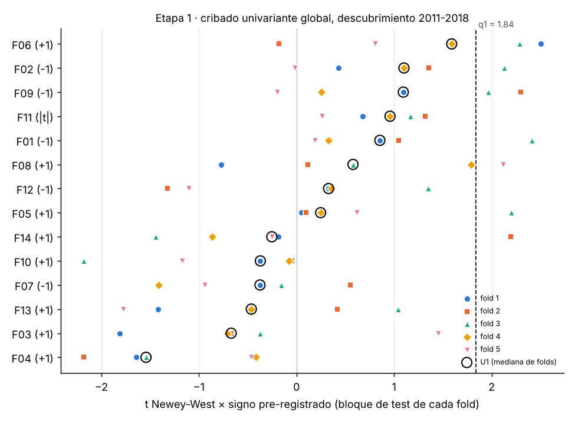
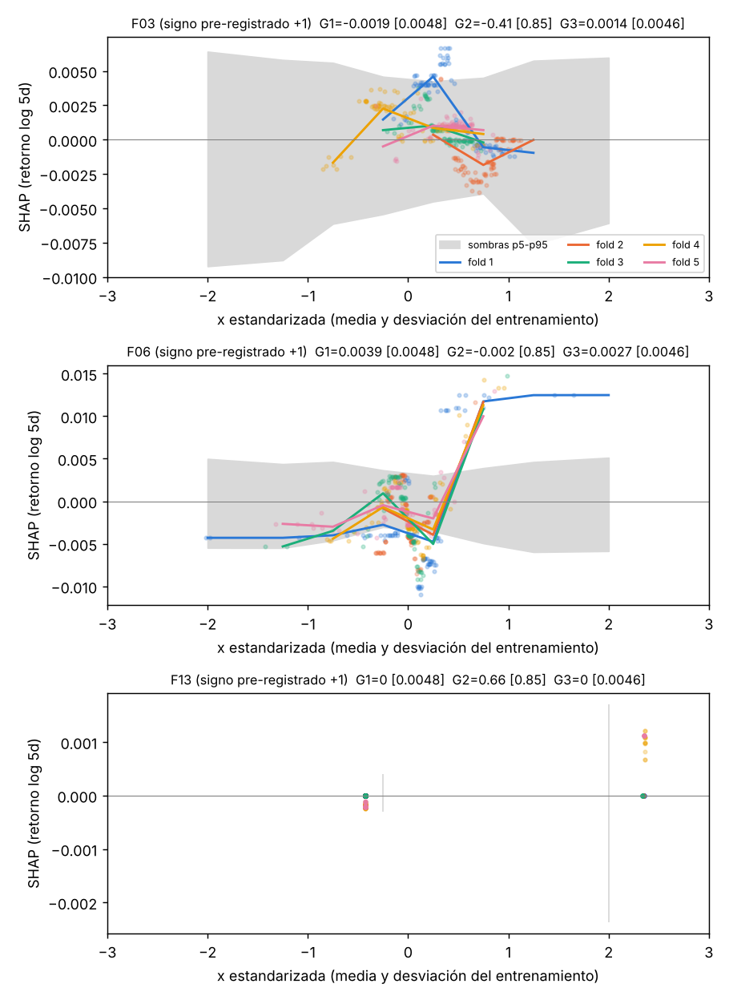

# Línea 1A · versión 2: mediana de los folds

Pre-registro `preregistro/preregistro_1A_v2_mediana.yaml` (2026-10-25). Es una **reapertura del pre-registro**
hecha después de ver los resultados de la v1, así que es un ensayo nuevo: sus entradas en `resultados/trials.jsonl`
llevan `version_prereg = v2_mediana` y se suman a las de la v1 para el DSR y el PBO.

**Único cambio**: los estadísticos de estabilidad se resumen con la **mediana de los 5 folds** en vez del peor fold,
en la etapa 1 (U1, U2) y en la etapa 2 (L1 de ridge y elastic net, G1, G2, I1). G3 ya era una mediana. Datos,
candidatas, signos, folds, sombras, semillas y modelos son los mismos de la v1.

## Resultado

**Sigue siendo nulo.** Ninguna candidata pasa la etapa 1; F06 (VRP) cumple ahora en los dos modelos lineales pero
no en el GBM, así que como excepción teórica tampoco entra. Catálogo vacío, validación igual a la v1 (media
histórica, R² OOS = 0) y holdout sin abrir.

## Etapa 1

La mediana sube las candidatas, pero también sube la nula: el ruido con mejor mediana entre 42 contrastes es más
alto que el ruido con mejor peor fold.

| | v1 (peor fold) | v2 (mediana) |
| --- | --- | --- |
| q1 (p95 del máximo de U1 en las sombras) | 0,88 | **1,84** |
| q2 (p95 del máximo de U2) | 0,50 | **0,80** |

| Variable | Corte | Signo | U1 = t mediano | U2 = monotonía mediana | p perm. individual | Réplicas en que la mejor sombra la supera |
| --- | --- | --- | --- | --- | --- | --- |
| **F06 VRP** | global | + | **1,59** | 0,5 | 0,009 | 16 % |
| F02 distancia a SMA20 | mercado alcista | − | 1,32 | 0,4 | 0,019 | |
| F09 amplitud sectorial | mercado alcista | − | 1,31 | 0,0 | 0,008 | |
| F02 distancia a SMA20 | global | − | 1,10 | 0,3 | 0,040 | |
| F09 amplitud sectorial | global | − | 1,09 | 0,3 | 0,010 | |
| F08 RSP − SPY | mercado alcista | + | 1,05 | 0,4 | 0,048 | |
| F01 reversión 5d / σ | mercado alcista | − | 1,01 | 0,1 | 0,061 | |
| F11 ΔT10Y2Y (sin signo) | global | 0 | 0,96 | 0,6 | 0,31 | |
| F01 reversión 5d / σ | global | − | 0,85 | 0,3 | 0,067 | |

Lectura:

- **Cambia el orden.** Con la mediana, el mejor candidato es F06 (VRP): t mediano 1,59, el más cercano al umbral.
  Pasaría en un umbral alrededor del percentil 84 de la nula; con el p95 pre-registrado no pasa.
  Su monotonía (0,5) tampoco llega al q2 de 0,80.
- **Aparece la amplitud sectorial (F09)** con p individual 0,008-0,010, pero sin forma (U2 0,0-0,3).
- **Reversión (F01, F02)** mejora algo, sobre todo en mercado alcista, sin acercarse a 1,84.
- Momentum, crédito y calendario siguen con t mediano negativo.

## Etapa 2 (solo las excepciones F03, F06, F13)

| Variable | L1 ridge [umbral] | L1 enet [umbral] | G1 [umbral] | G2 [umbral] | G3 [umbral] | Clase |
| --- | --- | --- | --- | --- | --- | --- |
| F03 | 0,00013 [0,00086] | −0,00019 [0,00214] | −0,0019 [0,0048] | −0,41 [0,85] | 0,0014 [0,0046] | descartada |
| **F06** | **0,0023** [0,00086] | **0,0055** [0,00214] | 0,0039 [0,0048] | −0,00 [0,85] | 0,0027 [0,0046] | descartada |
| F13 | 0,00029 [0,00086] | 0,00030 [0,00214] | 0 [0,0048] | 0,66 [0,85] | 0 [0,0046] | descartada |

F06 **cumple en lineal** (ridge y elastic net por encima de sus sombras con la mediana) pero **no en el GBM**: la
pendiente SHAP se queda a un 80 % del umbral y la forma no es monótona (el efecto de umbral de la v1, plano hasta
~+0,5 desviaciones y luego alto). Una excepción solo entra como "supresión sospechosa" si cumple en lineal y GBM.

## Validación, nula y criterios

- Validación 2019-2022: catálogo vacío → media histórica (Sharpe neto 0,16, R² OOS = 0). DSR y PBO no aplican.
- Nula del procedimiento con la mediana: __NULA_V2__
- Criterios 7.6: fallan todos. **El holdout sigue sellado.**

## Qué aprendemos de la v2

- El peor fold no era el único freno: con la mediana el umbral del ruido sube de 0,88 a 1,84, porque la mediana
  también favorece a las sombras afortunadas. Relajar la agregación no regala significación.
- F06 (VRP) es la candidata más sólida en las dos versiones: significativa en todo el periodo (t = 2,19), primera
  con la mediana y lineal por encima de sus sombras. Lo que falla es la forma: es un efecto de umbral, no lineal ni
  monótono. Si se quiere seguir, la siguiente reapertura natural es pre-registrar F06 en forma de umbral
  (p. ej. VRP por encima de su p70 de los 3 años previos). Sería la v3 y sumaría otro ensayo.

## Diagnóstico del GBM para F06 (sin cambiar la configuración)

`scripts/diagnostico_f06.py`, con 30 réplicas y los mismos offsets de la etapa 2. Resultados en
`diagnostico_f06/`. No es una configuración nueva, así que no suma en `trials.jsonl`.

| Fold | 1 | 2 | 3 | 4 | 5 |
| --- | --- | --- | --- | --- | --- |
| Semanas de entrenamiento | 196 | 279 | 363 | 446 | 529 |
| Hojas por árbol, sin sombras (máx. 7) | 3,6 | 4,5 | 4,7 | 4,5 | 4,6 |
| Cortes en F06, sin sombras | 383 | 516 | 612 | 531 | 511 |
| Cortes en F06, con sombras | 199 | 254 | 317 | 307 | 311 |
| Cortes en la sombra de F06 | 205 | 233 | 267 | 264 | 262 |
| G1 sin / con sombras | 0,0059 / 0,0039 | 0,0042 / 0,0026 | 0,0018 / 0,0021 | 0,0076 / 0,0070 | 0,0029 / 0,0037 |
| G2 sin / con sombras | 0,09 / 0,05 | 0,01 / −0,16 | −0,45 / −0,43 | −0,05 / −0,00 | −0,10 / 0,08 |
| G3 sin / con sombras | 0,0066 / 0,0051 | 0,0036 / 0,0026 | 0,0034 / 0,0027 | 0,0031 / 0,0029 | 0,0023 / 0,0020 |

1. **Hoja mínima (fold 1)**: limita poco. Los árboles del fold 1 usan 3,6 hojas frente a ~4,5 en los demás, y
   F06 recibe igualmente la mitad de los cortes. No es lo que la deja fuera.
2. **Competencia con las sombras**: es real. Las sombras se llevan la mitad de los cortes, la de F06 tanto como
   la propia F06, y G1 y G3 bajan entre un 10 % y un 35 % en los folds 1-2. Aun así, sin sombras las medianas
   (G1 0,0042, G3 0,0034) siguen por debajo de los umbrales actuales (0,0048 y 0,0046). Además, esos umbrales
   cambiarían con modelos separados, así que no se puede afirmar que F06 pasaría.
3. **La forma es el freno principal**: G2 (monotonía) está en torno a 0 con y sin sombras y en todos los folds.
   Ni la hoja mínima ni las sombras lo explican: el efecto de F06 es de umbral, no monótono.
