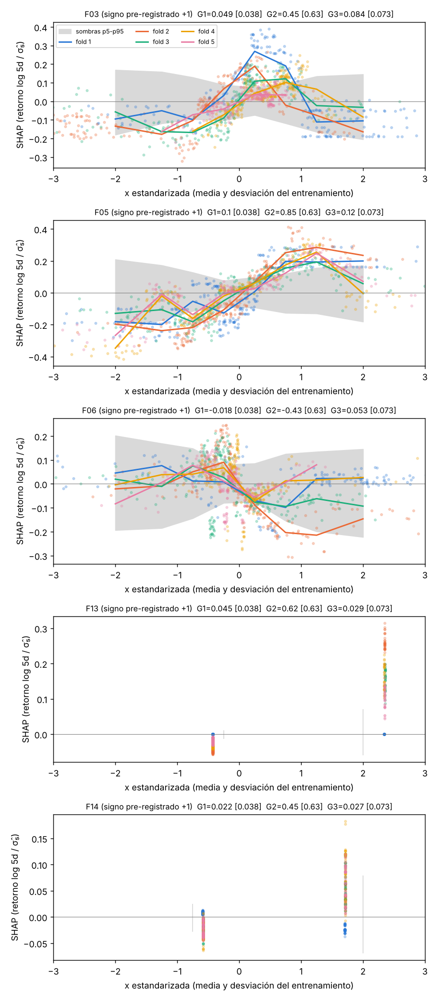

# Línea 1A · versión 5: umbrales calibrados al 5 % de error total (última reapertura)

Pre-registro `preregistro/preregistro_1A_v5.yaml`, congelado el 2026-10-26 (SHA-256 `b3b9a8f2…f52b`). Cuarta y
última reapertura de la línea 1A. Ensayos acumulados en `resultados/trials.jsonl` (29 tras la validación de la v5).

## El cambio: calibrar el procedimiento completo, no cada filtro

En la v1-v4 cada filtro (U1, U2, L1 ridge, L1 elastic net, G1, G3) usaba el percentil 95 del máximo de las sombras.
Encadenados, el error real del procedimiento era 0/100, muy por debajo del 5 % buscado. La v5 usa un único percentil
p para todos los umbrales, calibrado sobre 100 conjuntos sin señal (objetivo desplazado, semillas distintas de la
nula v4; `resultados/calibracion_v5`). Regla fijada antes de calibrar: el p más bajo de la rejilla con ≤ 5 % de
conjuntos que den alguna variable estable.

| p | 95 … 70 | 65 | 60 | **50** |
| --- | --- | --- | --- | --- |
| Falsos positivos del procedimiento | 0 % | 1 % | 2 % | **3 %** |

**p\* = 50**: la mediana del ruido como umbral en cada filtro deja el error total en el 3 %. Todo lo demás es igual
que en la v4 (test 1997-2018, objetivo y/σ̂₅, 10 candidatas, media de folds, U2 agregado, GBM con G1 + G3).

**Nota de transparencia.** Al verificar que el código reproducía la v4 con p = 95, se imprimió el umbral q1 de la v4
real con p = 80 (1,53), lo que indicaba que F14 en mercado alcista (U1 = 1,65) pasaría la etapa 1 con p ≤ 80. La
calibración no usa el retorno real y la regla estaba fijada antes; aun así queda anotado.

## Potencia con p = 50 (`resultados/potencia_completa_v5`, 30 réplicas, ruido alineado con las crisis)

| Efecto plantado | v4 (p = 95) | v5 (p = 50) |
| --- | --- | --- |
| Ninguno (falsos positivos) | 0/30 | **0/30** |
| F01 lineal, R² 0,5 % | — | **70 %** |
| F01 lineal, R² 1 % | ~32 % (solo etapa 1) | **97 %** |
| F01 lineal, R² 2 % | 93 % | **100 %** |
| F06 lineal, R² 4 % | 0 % | **83 %** |
| F06 umbral, R² 4 % | 30 % | **90 %** |

## Resultado con los datos reales

### Catálogo (`04_catalogo_1A.csv`)

| Variable | Etapa 1 | Clase final |
| --- | --- | --- |
| **F05 cambio del VIX a 5 días** | condicional, mercado alcista | **estable condicional (R_trend = 1)** |
| F03 momentum 12-1 | excepción teórica | supresión sospechosa |
| F14 cambio de mes | condicional, mercado alcista | redundante (comparte efecto con F05) |
| F06 VRP, F13 FOMC | excepción teórica | descartadas |
| F01, F02, F04, F07, F11 | no pasan | descartadas (F01 y F02 están en el cluster de F05) |

**Etapa 1** (q1 = 1,309; q2 = 0,092): pasan F05 en mercado alcista (t medio **1,313**, por solo 0,004 sobre el
umbral; IC de rangos 0,142; signo esperado en 5/5 folds; p individual 0,002) y F14 en mercado alcista (t medio 1,65).

**Etapa 2** (umbrales al p50):

| Variable | L1 ridge [0,029] | L1 enet [0,005] | G1 [0,038] | G3 [0,073] | I1 [0,001] | Resultado |
| --- | --- | --- | --- | --- | --- | --- |
| **F05** | 0,098 ✓ | 0,067 ✓ | 0,102 ✓ | 0,119 ✓ | 0,007 ✓ | estable condicional |
| F03 | 0,029 ✓ | 0,007 ✓ | 0,049 ✓ | 0,084 ✓ | — | supresión sospechosa |
| F14 | 0,058 ✓ | 0,040 ✓ | 0,022 ✗ | 0,027 ✗ | 0,009 ✓ | redundante |
| F13 | 0,058 ✓ | 0,035 ✓ | 0,045 ✓ | 0,029 ✗ | — | descartada |
| F06 | −0,000 ✗ | 0,000 ✗ | −0,018 ✗ | 0,054 ✗ | — | descartada |

La forma de F05 es la más clara de todo el análisis: en los cinco folds la contribución SHAP crece de forma monótona
con el cambio del VIX (más miedo reciente → más retorno a 5 días), fuera de la banda de las sombras. Es el efecto de
"rebote tras picos de miedo" del pre-registro, aquí solo dentro de mercados alcistas. F03 tiene forma de U invertida,
no monótona.

### Validación 2019-2022 (reentreno anual desde 1993)

| Modelo | R² OOS | Clark-West p | Sharpe neto | CER vs media hist. | CER vs comprar y mantener | Rotación anual |
| --- | --- | --- | --- | --- | --- | --- |
| **Ridge (F05 × mercado alcista)** | **+0,78 %** | 0,14 | 0,39 | +2,4 % | −1,6 % | 26 |
| Ridge, Campbell-Thompson | +1,03 % | 0,12 | 0,39 | +2,4 % | −1,6 % | 26 |
| GBM | −0,41 % | 0,28 | 0,35 | +1,4 % | −2,7 % | 32 |
| Ridge + F03 (sospechosa) | +0,56 % | 0,23 | 0,36 | +1,9 % | −2,1 % | 24 |
| Media histórica | 0 | — | 0,19 | — | — | 5 |
| Comprar y mantener | — | — | 0,51 | — | — | 0,3 |

- **DSR = 0,937** (29 ensayos acumulados, líder ridge, Sharpe 0,39): no llega a 0,95.
- **PBO = 0,67** (CSCV, S = 16, 3 estrategias distintas): por encima de 0,5.
- F03 no se confirma en validación (empeora el ridge), así que no entra al modelo final.

Correcciones antes de dar estos números: la variante "ridge + sospechosas" generaba filas duplicadas con métricas de
la media histórica y de comprar y mantener, y se habían registrado como ensayos; se quitaron de `trials.jsonl` y se
repitió la validación (misma configuración). En el PBO se quitan las estrategias con retornos idénticos (ridge y
ridge_ct dan los mismos pesos porque la regla ya trunca en 0).

## Nula del procedimiento y criterios 7.6

**Nula del procedimiento** (100 corridas con y_norm desplazado, `06_nula_procedimiento.csv`): 3/100 corridas dan una
variable estable (F01 dos veces, F14 una), lo esperado con la calibración (3 %).

| Métrica | Real | p95 de la nula | Corridas nulas que igualan o superan el real |
| --- | --- | --- | --- |
| Nº de variables estables | 1 | 0 | 3/100 |
| R² OOS validación (ridge) | 0,78 % | 0 | **0/100** (máximo nulo 0,53 %) |
| Sharpe neto validación | 0,39 | 0,19 | 2/100 |

**Criterios 7.6** (`08_criterios_holdout.json`):

| Criterio | Resultado |
| --- | --- |
| R² OOS > 0 y Clark-West p < 0,10 | ✗ (R² +0,78 %, p = 0,14) |
| DSR > 0,95 | ✗ (0,937) |
| PBO < 0,5 | ✗ (0,67) |
| Nº estables > p95 de la nula | ✓ (1 frente a 0) |
| R² OOS > p95 de la nula | ✓ (0,78 % frente a 0) |

**El holdout no se abre**: fallan tres de los cinco criterios. El procedimiento sí se distingue del ruido (ninguna de
las 100 corridas nulas iguala el R² OOS real), pero la mejora no es lo bastante grande ni robusta frente a los 29
ensayos acumulados.

## Conclusión de la línea 1A

- Con un procedimiento calibrado al 5 % de error total y con potencia alta (97 % para R² 1 %), aparece **una
  característica estable: F05, el cambio del VIX a 5 días, en mercados alcistas**. Es coherente con el pre-registro
  (signo +, rebote tras picos de miedo) y con la familia de reversión que asomaba en todas las versiones.
- **En validación aporta poco**: R² OOS +0,78 %, pero sin significación (Clark-West p = 0,14), con un Sharpe que
  mejora el de la media histórica y no el de comprar y mantener en 2019-2022, y con DSR y PBO por debajo de sus
  umbrales. Los criterios para abrir el holdout no se cumplen.
- La línea 1A queda cerrada con este catálogo: **F05 condicional (R_trend = 1)** como única variable estable y F14
  como redundante. Para 1B, el pre-registro admite como meta-features las estables y las redundantes, más R_vol y R_trend.
